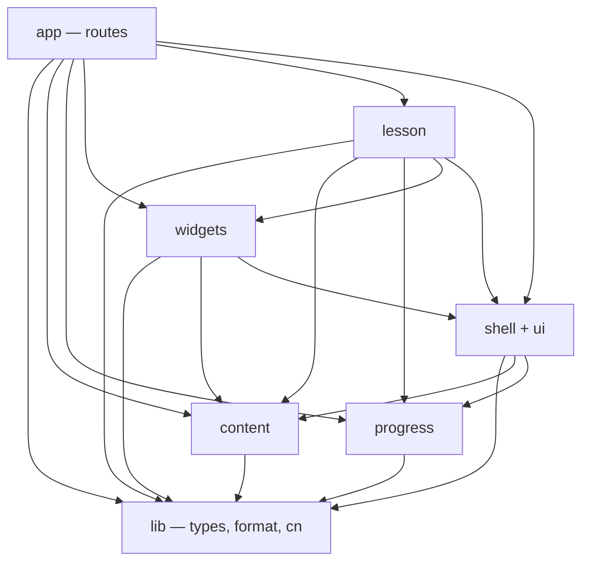

# Stage 4 — High-level design: architecture

This document sets the stack, modules, data flow, and build plan. Stage 5 and the build agents
use it as a contract. `3-prd.md` binds behavior; BUILD_GUIDE section 2 binds the stack.

## 1. Stack decision

| Concern | Decision |
| --- | --- |
| Framework | Next.js App Router |
| Language | TypeScript, `strict: true` |
| Styling | Tailwind CSS, one token file |
| Packages and runtime | npm, Node.js 22 LTS |
| Data | Fixed TypeScript modules and one localStorage record |
| Server | None |

Version strategy: install the latest stable release of each package at scaffold time. Record
exact versions in `package.json` with no caret range. Commit `package-lock.json`. Upgrade only
with a build check. Follow the installed Tailwind major version.

No database: all lessons, widget data, and scores are fixed at build time. One small record per
lesson is the only mutable data. localStorage meets US-13 to US-15. A database adds a server, a
schema, and failure states for no benefit.

No auth: there is no per-user data and no server.

No API routes: no work remains at request time. Both widgets are pure functions over fixed data.

## 2. Rendering strategy

All routes are static. Each page is a server component unless it needs state, an effect, or a
browser API. `app/lessons/[slug]/page.tsx` calls `generateStaticParams()` and sets
`dynamicParams = false`. No component fetches data.

This is the complete list of client components:

- Shell: `ProgressProvider`, `StorageBanner`, `HeaderProgress`, `Spine`, `ResetProgress`.
- Home: `RunPanel`, `HomeAction`, `LessonLedger`.
- Lesson: `CheckBlock`, `TaskChecklist`, `ProveNote`, `RepairButton`, `LessonToc`, `CopyButton`,
  `LessonPosition`, `LessonKeyboardNav` (P1).
- Roadmap: `RoadmapTable`, `RoadmapAction`.
- Widgets: `RetrievalExplorer`, `CostCalculator`.
- Optional P2: `SearchDialog`, cut unless the quality wave leaves time.

All other components are server components.

## 3. Module decomposition

Arrow means "imports". The graph has no cycles.



### `content`

Purpose: hold every fixed fact. No JSX.

```ts
export const LESSONS: readonly Lesson[];            // course order, six items
export function getLesson(slug: string): Lesson | undefined;
export const ROADMAP: readonly RoadmapItem[];
export const RETRIEVAL_DOCS: readonly RetrievalDoc[];
export const COST_DEFAULTS: CostInputs;
export function scoreSummary(repaired: readonly LessonSlug[]): Scores;
```

Owns `content/**`. Depends on `lib/types.ts` only. Each lesson has one file.

### `progress`

Purpose: own reader state and local persistence.

```ts
export function ProgressProvider(props: { children: ReactNode }): ReactElement;
export type ProgressApi = {
  state: ProgressState; ready: boolean; storage: 'ok' | 'unavailable';
  repair(slug: LessonSlug): void;
  patch(slug: LessonSlug, change: Partial<LessonProgress>): void;
  reset(): void;
};
export function useProgress(): ProgressApi;
```

Owns `lib/progress/**`: store, storage adapter, selectors, context. Depends on `lib/types.ts`.

### `lesson`

Purpose: render a lesson and run its loop.

```ts
export function LessonArticle(props: { lesson: Lesson }): ReactElement;
export function CheckBlock(props: { slug: LessonSlug; check: Check }): ReactElement;
export function TaskChecklist(props: { slug: LessonSlug; task: Task }): ReactElement;
export function ProveNote(props: { slug: LessonSlug; prompt: string }): ReactElement;
export function RepairButton(props: { lesson: Lesson }): ReactElement;
```

Owns `components/lesson/**` and `app/lessons/[slug]/page.tsx`. Depends on content, progress,
widgets, shell UI, and lib.

### `widgets`

Purpose: hold both deterministic teaching tools.

```ts
export function RetrievalExplorer(): ReactElement;
export function CostCalculator(props: { defaults: CostInputs }): ReactElement;
export function rankDocuments(query: string, docs: readonly RetrievalDoc[]): readonly RetrievalHit[];
export function estimateCost(input: CostInputs): CostResult;
```

Owns `components/widgets/**`. Depends on content, shell UI, and lib. The two pure functions have
no React dependency and are unit-testable.

### `shell`

Purpose: hold layout, chrome, spine, and UI primitives.

```ts
export function SiteHeader(): ReactElement;
export function SiteFooter(): ReactElement;
export function Spine(props: { active?: LessonSlug }): ReactElement;
export function StorageBanner(): ReactElement;
export { Button, Badge, Panel, Prose, Rule } from './ui';
```

Owns `app/layout.tsx`, `app/globals.css`, `components/shell/**`, and `components/ui/**`. Depends
on content, progress, and lib. Constraint: `components/ui/**` is a leaf. It imports `lib/cn.ts`
only.

The `app/` pages are the composition root and hold no logic.

## 4. Data flow: reader repairs a layer

State lives in one immutable `ProgressState` snapshot in `lib/progress/store.ts`. The persisted
copy is at `lastminute.progress.v1`. React context carries it; the URL holds no progress state.

1. Build: `app/layout.tsx` mounts `ProgressProvider` with the empty snapshot. Server HTML shows
   "0 of 6 layers repaired".
2. First client paint uses the same snapshot. Hydration cannot mismatch.
3. After mount, the provider calls `hydrate()`: read storage in `try/catch`, check version and
   shape, publish the snapshot.
4. The reader opens `/lessons/retrieval`. `RepairButton` subscribes. The gate is all checks
   correct, 5 ticks, and a non-empty proof.
5. The reader clicks "Mark layer repaired". `RepairButton` calls `repair('retrieval')`.
6. The store builds the next snapshot, writes JSON, and notifies subscribers. A failed write
   keeps memory state and sets `storage: 'unavailable'`.
7. Consumers re-render: `RepairButton`, `Spine` (green node), `HeaderProgress` ("1 of 6"),
   `RunPanel`, `LessonLedger`, `RoadmapTable`, and `HomeAction`.
8. `RunPanel` calls `scoreSummary(['retrieval'])`. The result is 58% pass, $0.71 per 1k, and
   p95 1.4 s. The numeral roll plays unless reduced motion is set.
9. Reload repeats steps 1 to 3. The repaired layer, the note, and the position return.

## 5. Directory tree

```text
lastminute-dev/
  app/
    layout.tsx
    globals.css
    page.tsx                   # SCR-01
    not-found.tsx              # SCR-00, status 404
    roadmap/page.tsx           # SCR-03
    about/page.tsx             # SCR-04
    lessons/[slug]/page.tsx    # SCR-02
  components/
    ui/                        # Button, Badge, Panel, Prose, Rule
    shell/                     # SiteHeader, SiteFooter, Spine, StorageBanner
    lesson/                    # LessonArticle, CheckBlock, TaskChecklist, ProveNote
    widgets/                   # RetrievalExplorer, CostCalculator, rank, cost
    home/                      # RunPanel, MappingPanel, LessonLedger, HomeAction
    roadmap/                   # RoadmapTable, RoadmapAction, RoadmapIntro
  lib/
    types.ts
    cn.ts
    format.ts
    progress/
      store.ts                 # snapshot, actions, subscribe
      storage.ts               # guarded adapter
      context.tsx              # ProgressProvider, useProgress
      selectors.ts             # gate, counts, resume target
  content/
    index.ts
    scores.ts
    roadmap.ts
    lessons/{evaluation,prompt-contract,retrieval,agents,fine-tuning,cost}.ts
  public/favicon.svg
  .env.example
  .nvmrc
  next.config.ts
  package.json
  package-lock.json
  tsconfig.json
  postcss.config.mjs
```

## 6. Contracts and boundaries

| Rule | Meaning |
| --- | --- |
| Public surface | Each module has one `index.ts`. External files import only that path. |
| Direction | `app` imports every module. `lesson` imports shell UI, widgets, progress, content, lib. `widgets` imports shell UI, content, lib. `shell` imports progress, content, lib. `progress` and `content` import lib only. The section 3 graph is the full allowed edge set. |
| One type file | `lib/types.ts` holds every shared type, including `LessonSlug`, `Lesson`, `Check`, `Scores`, and `ProgressState`. |
| Client boundary | `'use client'` appears only in the files listed in section 2. A server file never imports `lib/progress/store.ts`. |
| Data only | Content files export frozen data and pure functions. They contain no JSX. |
| No internals | A module never imports another module's internal file. |
| Enforcement | One ESLint `no-restricted-imports` pattern per rule. Review checks the client list. |

## 7. Build and deployment

`next.config.ts` sets `output: 'export'` and `images.unoptimized: true`. `npm run build` runs
`next build` and writes `out/`. The output has four routes, six lesson pages, `404.html`, and
static assets. It has no server function and no route handler.

Vercel deployment needs zero configuration: import the repository, keep the detected Next.js
preset, and press deploy. There are no environment variables, no build override, and no
redirects. `.env.example` contains one comment: "No environment variables are required." Node 22
comes from `engines.node` and `.nvmrc`. Local scripts are `dev`, `build`, `lint`, `typecheck`,
and `test`.

## 8. Performance and failure strategy

- Hydration: the server snapshot is a frozen constant. Render code never calls `Math.random`,
  `Date.now`, `new Date`, or `crypto.randomUUID`. Control ids come from `useId`.
- Storage: every `getItem`, `setItem`, `removeItem`, and `JSON.parse` call sits in `try/catch`.
  A quota or parse error falls back to memory state and shows `StorageBanner`.
- Corrupt data: a wrong version or shape resets the record to the empty snapshot.
- Network: zero runtime requests. There is no `fetch` and no external font, image, or script.
  Fonts use system stacks (`ui-serif`, `ui-monospace`). Diagrams are inline SVG.
- 404: the lesson page calls `notFound()` for an absent slug. The export writes `out/404.html`
  from `app/not-found.tsx` with header and footer. Vercel returns status 404.
- Widgets: invalid input returns a message. No widget throws.
- Budget: first-load JavaScript stays under 150 kB gzip. React and Next are the only runtime
  libraries.

## 9. Build units

| ID | Unit | Owns | Depends on |
| --- | --- | --- | --- |
| U0 | Foundation | config files, `app/layout.tsx`, `app/globals.css`, `lib/types.ts`, `lib/cn.ts`, `lib/format.ts`, `components/ui/**`, `public/**` | none |
| U1 | Content | `content/**` | U0 |
| U2 | Progress | `lib/progress/**`, then the provider mount in `app/layout.tsx` | U0 |
| U3 | Shell chrome | `components/shell/**` | U0, U1, U2 |
| U4 | Lesson | `components/lesson/**`, `app/lessons/[slug]/page.tsx` | U0, U1, U2, U3, U5 |
| U5 | Widgets | `components/widgets/**` | U0, U1 |
| U6 | Pages | four `app/` pages, `components/home/**`, `components/roadmap/**` | U0 to U5 |
| U7 | Verification | no production files; `README.md`, `CLAUDE.md`, `AGENTS.md` | all |

Waves: U0 first; U1, U2, and U5 next; then U3 and U4; then U6; then U7. U1 freezes the `Lesson`
schema first, then writes six lesson files in parallel, one per writer. U4 and U5 share a wave
because section 3 fixes the widget props. U2 makes the `app/layout.tsx` provider edit before U3
starts. U7 changes source files only through the owning unit.

## 10. Rejected alternatives

- Vite: it gives no file routing, static generation for six slugs, or a 404 page. BUILD_GUIDE
  allows it only for a simple landing page.
- MDX: lesson shape is typed data with checks, ticks, and scores. MDX weakens type checks and
  adds a compiler.
- Supabase: the product has no accounts and no shared data. It adds keys, migrations, network
  states, and a failure mode the demo does not need.
- Client-side routing in one page: it loses per-route HTML, deep links, and a real 404 status.
